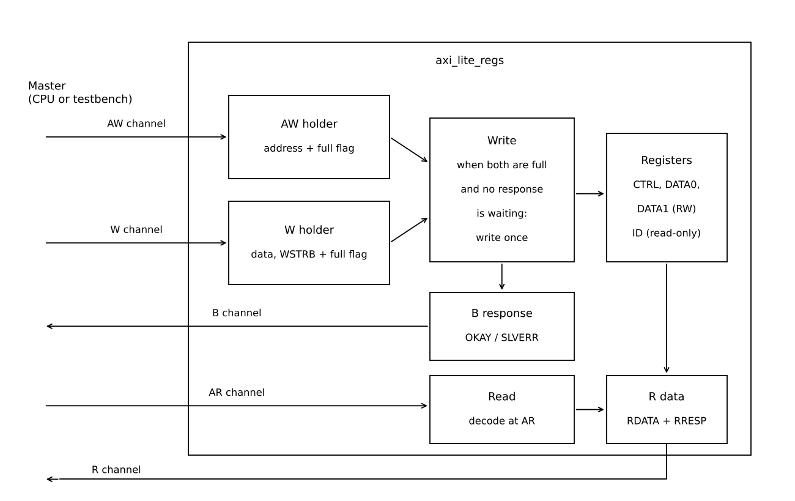
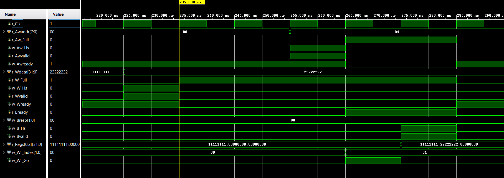
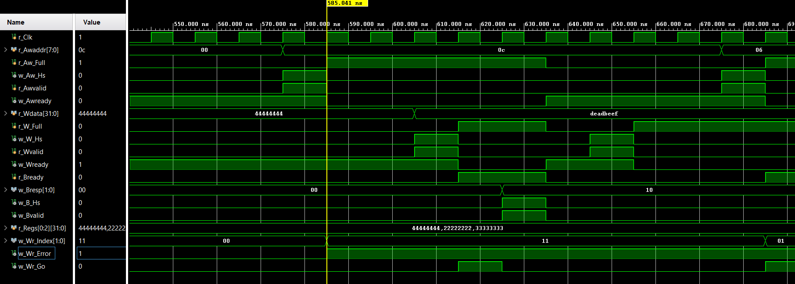

# AXI4-Lite Register Slave in SystemVerilog

An **AXI4-Lite slave** with a small register file: the same four registers as my APB slave,
behind the bus that Vivado IP and most SoC peripherals use. It is written in SystemVerilog,
verified with two self-checking testbenches (a directed one and a random one with a register
model and handshake assertions), and synthesized in Vivado for a Spartan-7 FPGA
(Digilent Arty S7-25).

## Results at a glance

| Check | Result |
|---|---|
| Directed testbench, 7 tests | **TEST PASSED**, 25 / 25 checks, in Vivado xsim and Icarus Verilog |
| Random testbench, 3 seeds x 2000 transactions | **TEST PASSED** for all 3 seeds (6000 random reads and writes), no assertion errors |
| Handshake assertions | 5, one per channel, checked on every clock |
| Synthesis | 178 flip-flops, 58 LUTs, no latches |

## What is AXI4-Lite?

AXI4-Lite is a bus protocol from Arm's AMBA family, used to read and write registers. Each
transfer is one 32-bit word, with no bursts. What makes it more complex than APB is that it
uses **five independent channels**, each with its own VALID/READY handshake: a write uses
AW, W and B, and a read uses AR and R.

| Channel | Direction | Carries |
|---|---|---|
| AW | master to slave | write address |
| W | master to slave | write data and byte strobes (WSTRB) |
| B | slave to master | write response (OKAY or SLVERR) |
| AR | master to slave | read address |
| R | slave to master | read data and response |

A word passes on a channel at the rising edge where **VALID and READY are both 1**. Once a
source raises VALID it must keep VALID and its data unchanged until READY. The write address
and the write data travel on separate channels, so they can arrive **in either order**, and
the slave has to handle all three cases: address first, data first, or both in the same clock.

## Design (`design/axi_lite_regs.sv`)



| Address | Name | Access | Reset |
|---|---|---|---|
| 0x00 | CTRL | RW | 0 |
| 0x04 | DATA0 | RW | 0 |
| 0x08 | DATA1 | RW | 0 |
| 0x0C | ID | RO | 0xA9B0_0001 |

- **Address and data in either order.** The address and the data each go into their own
  holding register, with a "full" flag. While a holder is full, its READY is 0, so a second
  address or data word cannot overwrite the first one.
- **The write happens exactly once,** on the first clock where both holders are full and no
  response is waiting. At that same edge BVALID goes to 1. Without the "no response waiting"
  condition the register would be written again on every clock until the master takes the
  response, which matters for registers where a write has a side effect.
- **Byte strobes:** WSTRB selects which of the four bytes are written; the others keep their
  value.
- **Errors:** a write to ID, an address of 0x10 or above, or an address that is not a multiple
  of 4 gets **SLVERR** and changes nothing. The same out-of-range and unaligned reads get SLVERR
  with data 0. Reading ID is allowed.
- **Read path:** the address is decoded at the AR handshake and the data is stored in a
  register, so RDATA cannot change while RVALID waits for RREADY. ARREADY is 0 while read data
  is waiting.
- **Responses are held:** BVALID/BRESP and RVALID/RDATA/RRESP stay unchanged until the master
  is ready.
- **Reset:** synchronous, active low (ARESETn). Only what controls behaviour is reset: the full
  flags, BVALID, RVALID and the three registers. The holding registers, RDATA and the responses
  are only used while their flag or VALID is set, so they have no reset.
- AWPROT and ARPROT are accepted and not used.

## Verification

### Directed testbench (`simulation/axi_lite_regs_tb.sv`)

The testbench acts as the AXI master. It runs seven hand-picked tests, one for each feature of
the slave (reset values, the three write orders, a slow master, errors and byte strobes), and
compares every response and every value read back with the expected one, printing PASS or FAIL.

| # | Test | Expected |
|---|---|---|
| 1 | during reset | BVALID = 0, RVALID = 0 |
| 2 | read all registers after reset | 0, 0, 0, 0xA9B0_0001 |
| 3 | writes with address first, data first, and both in the same clock | OKAY, values read back |
| 4 | master slow to take the response (BREADY / RREADY 3 clocks late) | response held, OKAY |
| 5 | write to ID, to 0x06, to 0x14 | SLVERR, registers unchanged |
| 6 | write with WSTRB = 0101 | only bytes 0 and 2 change |
| 7 | read 0x10 and 0x0A | SLVERR, data 0 |

Log: `results/axi_lite_regs_tb_console.txt` (25 / 25, ends at 965 ns).

### Random testbench (`simulation/axi_lite_regs_random_tb.sv`)

The testbench acts as an AXI master that behaves randomly: each run does 2000 random reads and
writes with random timing, checks every answer against a model of the registers, and checks the
handshake rule with assertions on every clock. It was run with three seeds, so three different
random sequences:

- **Random master:** the address and the data each wait a random 0 to 4 clocks before VALID,
  so they arrive in any order. Before BREADY and RREADY the master waits a random 0 to 5
  clocks, so the slave has to hold its responses.
- **Random content:** addresses are mostly the four registers and sometimes any address from
  0x00 to 0xFF (so many are bad), with random data and random byte strobes.
- **Register model:** the testbench keeps its own copy of the registers, written from the
  register map and not copied from the RTL. Before each write it predicts OKAY or SLVERR and
  then updates its copy (using a byte mask); before each read it predicts the data and the
  response. Every answer from the slave is compared with the prediction.
- **Assertions:** one SystemVerilog assertion per channel checks the handshake rule on every
  clock: if VALID is 1 and READY is 0, then at the next clock VALID is still 1 and the data
  has not changed. A failing assertion is counted, so the run ends with TEST FAILED.

| Seed | Result | Run ends at |
|---|---|---|
| default | TEST PASSED, 2000 transactions | 138,195 ns |
| `-sv_seed 7` | TEST PASSED, 2000 transactions | 139,775 ns |
| `-sv_seed 42` | TEST PASSED, 2000 transactions | 141,835 ns |

Log: `results/axi_lite_regs_random_tb_console.txt`.

One honest limit: The hold rule can only be checked while a channel is waiting.This slave is always ready
on AW, W and AR, so those channels never waited; the rule was exercised on B and R, where the
master delays BREADY and RREADY.

### Waveforms

A write where the data arrives first. The data is stored at 235 ns, the address at 265 ns;
at 275 ns DATA0 changes and BVALID goes to 1 at the same edge; the response is taken at 285 ns.



A write to the read-only ID register: the response is SLVERR (BRESP = 2'b10) and no register
changes.



## Synthesis (Vivado 2025.2, xc7s25csga324-1)

| LUTs | Flip-flops | Latches | Bonded I/O |
|---|---|---|---|
| 58 | 178 (176 FDRE, 2 FDSE) | 0 | 100 |

- I counted 180 flip-flops in the code. BRESP and RRESP are only ever 00 or 10, so their
  bit 0 is always 0 and Vivado removes those two flip-flops: 178.
- The 2 FDSE are flip-flops that reset to 1. I believe Vivado stored AWREADY and WREADY
  directly (they are the inverse of the full flags, and 1 after reset).
- The block was synthesized as its own top level, so the report counts I/O pins: 106 ports
  minus the 6 unused AWPROT/ARPROT bits gives 100. Behind an interconnect it would use none.

Warnings, and why they are expected:
- `Synth 8-7129` x12, "port has no load": the 3 AWPROT and 3 ARPROT bits, each listed twice.
  They are unused on purpose; the ports stay so the interface is a complete AXI4-Lite port.

Report: `results/axi_lite_regs_utilization.txt`.

## What I learned

- **Two channels arriving in any order need somewhere to wait.** Holding registers with full
  flags, and READY tied to "not full", were enough to handle all three orders.
- **"Write once" needs its own condition.** Both flags stay set until the response is taken,
  so the write condition also has to check that no response is already waiting.
- **Only reset what controls behaviour.** In the waveform BRESP shows X until the first write,
  which is expected: it has no reset and is only looked at while BVALID is 1.
- **A random test needs a model.** With random addresses, data and strobes I could not write
  the expected values by hand, so the testbench predicts them from the register map. Writing
  the model differently from the RTL (a byte mask instead of a loop) means a mistake in one is
  not copied into the other.
- **Assertions see what the model cannot.** The model only checks results; a VALID that drops
  for one clock with the right data would pass the model, but not the assertions.

## What I got wrong

- **My first seed line did not run in Vivado.** `$urandom(seed)` inside the code works in
  Icarus, but Vivado's simulator rejected it (XSIM 43-3122). I removed it and set the seed with
  the simulator option `-sv_seed` instead.
- **A "default" run on my second computer ended at a different time** from the first one. Same
  testbench and same simulator should give exactly the same run, so I checked: a `-sv_seed 7`
  was still in the simulation settings. With the box empty both computers end at 138,195 ns,
  and seed 7 always ends at 139,775 ns.

## Repository layout

```
axi-lite-regs/
  design/       axi_lite_regs.sv              AXI4-Lite register slave
  simulation/   axi_lite_regs_tb.sv           directed testbench
                axi_lite_regs_random_tb.sv    random testbench with model and assertions
  results/      console logs, waveforms, utilization report, block diagram
```

## How to reproduce

1. **Vivado:** RTL project, part xc7s25csga324-1. Add `design/axi_lite_regs.sv` as a design
   source and a testbench from `simulation/` as a simulation source, set it as the simulation
   top, run Behavioral Simulation, then `run all` in the Tcl console.
2. **Seed for the random testbench:** Simulation Settings, Simulation tab,
   `xsim.simulate.xsim.more_options` = `-sv_seed 7` (empty = default seed).
4. **Synthesis:** set `axi_lite_regs` as top, run synthesis, then
   `report_utilization -file results/axi_lite_regs_utilization.txt`.

