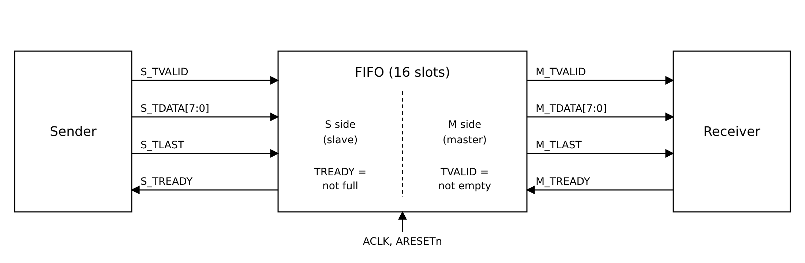
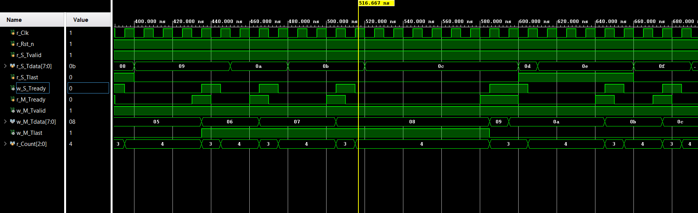
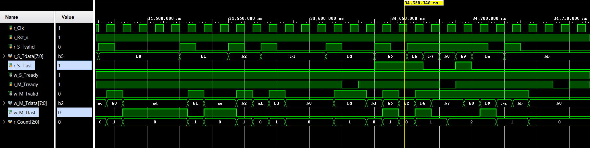

# AXI4-Stream FIFO in SystemVerilog

An **AXI4-Stream FIFO**: The bytes and their TLAST go in on one side of the fifo and come out on the other in
the same order. When the FIFO is full it sets TREADY to 0 so the sender waits and when it is empty it sets TVALID to 0 so the receiver waits. It is built around my [synchronous FIFO](https://github.com/micahpinto/synchronous-fifo), verified with a self-checking random testbench and synthesized in Vivado for a Spartan-7 FPGA.

## Results at a glance

| Check | Result |
|---|---|
| Random testbench, 6000 clocks, FIFO depth 4 | **TEST PASSED**, 1699 bytes in, 1699 bytes out, 392 packets |
| Full and empty | full on 1893 clocks, empty on 1798 clocks |
| Handshake assertion | checked on every clock, no errors |
| Synthesis (depth 16) | 13 flip-flops, 23 LUTs (8 used as distributed RAM), 0 latches, 0 Block RAM |

## What is AXI4-Stream?

AXI4-Stream is the AMBA protocol for moving a **flow of data** from one block to the next, with
**no addresses**. There is one channel with a VALID/READY handshake:

| Signal | Direction | Meaning |
|---|---|---|
| TVALID | sender to receiver | the byte on TDATA is real |
| TREADY | receiver to sender | I can take a byte |
| TDATA | sender to receiver | the data byte |
| TLAST | sender to receiver | this byte is the last one of a packet |

A byte moves at the rising edge where **TVALID and TREADY are both 1**. Once the sender raises
TVALID it must keep TVALID, TDATA and TLAST unchanged until TREADY. When TVALID is 0, TDATA and
TLAST mean nothing and the receiver ignores them.

On each link one block sends (master) and one receives (slave). The FIFO is a **slave** on its
input side (S) and a **master** on its output side (M).

## Design



- **`design/fifo_count.sv`:** my synchronous FIFO (count method): a write pointer, a read
  pointer and a count from 0 to DEPTH that gives full and empty. I added a synchronous
  active-low reset so the FIFO can be emptied while running. The memory has no reset.
- **`design/axis_fifo.sv`:** the AXI4-Stream wrapper around it.
  - **TLAST is stored with its byte:** each slot is 9 bits, `{TLAST, TDATA}`, so packet
    boundaries come out exactly where they went in.
  - **S_TREADY = not full:** a byte is written when S_TVALID and S_TREADY are both 1.
  - **M_TVALID = not empty:** the front byte is on M_TDATA all the time, and it leaves when
    M_TVALID and M_TREADY are both 1.
  - **Reset:** synchronous, active low (ARESETn). It empties the FIFO, so M_TVALID is 0 during
    and after reset.
- Parameters: `DATA_W` (8) and `DEPTH` (16).

## Verification (`simulation/axis_fifo_tb.sv`)

The testbench is the sender on the S side and the receiver on the M side. It drives and checks
at the falling edge, while the FIFO works on the rising edge, so every value is stable when it
is read.

- **Random sender:** packets of 1 to 8 bytes with TLAST on the last byte, byte values counting
  up, and random gaps. A byte that was not taken stays on TDATA until it is.
- **Random receiver:** TREADY is random on every clock.
- **Three phases** of 2000 clocks each: slow receiver (90 % send, 20 % take) so the FIFO fills
  up, fast receiver (20 % / 90 %) so it drains, then balanced (50 % / 50 %). At the end the
  current packet is finished and the FIFO is drained.
- **Model:** a SystemVerilog queue holds every `{TLAST, byte}` that went in, oldest first. On
  every clock the testbench checks S_TREADY (room in the model), M_TVALID (model not empty) and
  the front byte and TLAST against the front of the queue. Then it updates the queue the same
  way the FIFO will change: `pop_front` when a byte leaves, `push_back` when one arrives.
- **Assertion:** if M_TVALID is 1 and M_TREADY is 0, then at the next clock M_TVALID is still 1
  and M_TDATA and M_TLAST have not changed.
- Also checked: M_TVALID is 0 during reset, and the FIFO is empty at the end.
- The testbench uses DEPTH = 4 so that full and empty happen often.

Result: TEST PASSED, 1699 bytes in and out, 392 packets, full on 1893 clocks, empty on 1798
clocks, run ends at 60,120 ns. Log: `results/axis_fifo_tb_console.txt`.

### Waveforms

**FIFO full (about 520 to 600 ns).** `r_Count` is 4 and S_TREADY is 0, so the sender holds byte
0c with S_TVALID = 1. On the output side the receiver is not ready and the FIFO holds byte 08.
When M_TREADY goes to 1, 08 leaves, the count drops to 3, S_TREADY goes back to 1 and 0c goes in.



**Packets and TLAST (about 34,480 to 34,720 ns).** Reading only the clocks where M_TVALID is 1:
b0 to b5 is a 6-byte packet with gaps, b6 is a 1-byte packet, and b7, b8, b9 is a 3-byte
packet. TLAST is 1 only on b5, b6 and b9, the same bytes that had TLAST on the input side.



## Synthesis (Vivado 2025.2, xc7s25csga324-1, DEPTH = 16)

| LUTs | Flip-flops | Latches | Block RAM | Bonded I/O |
|---|---|---|---|---|
| 23 (15 logic, 8 distributed RAM) | 13 (FDRE) | 0 | 0 | 24 |

- **13 flip-flops:** the two 4-bit pointers and the 5-bit count. All have a clock enable and a
  synchronous reset (FDRE).
- **The memory is not in flip-flops.** The 16 x 9 = 144 bits went into 8 LUTs used as
  distributed RAM (2 RAM32M blocks). Vivado chose this from the code: the write is on the clock
  edge but the read (`o_Rd_Data = r_Mem[r_Rd_Ptr]`) has no clock, and Block RAM can only read on
  a clock edge.
- **24 I/O:** 13 inputs and 11 outputs, because the block was synthesized as its own top level.

Report: `results/axis_fifo_utilization.txt`.

## What I learned

- **TLAST has to travel with its byte.** Storing it as a ninth bit in the same slot keeps
  packet boundaries correct without any extra logic.
- **Only read TDATA when TVALID is 1.** In the waveform, while the FIFO is empty M_TDATA shows
  old bytes from one lap ago in the memory, and M_TLAST can even be 1. This is allowed: M_TVALID
  is 0, so the receiver ignores them.
- **How the code is written decides the hardware.** A read with no clock gave distributed RAM;
  a clocked read would be needed for Block RAM, at the cost of one clock of delay.
- **Random numbers depend on the simulator.** The same testbench gives different byte counts
  in different simulators; the seed only repeats a run within the same simulator.

## Repository layout

```
axis-fifo/
  design/       fifo_count.sv       synchronous FIFO (count method)
                axis_fifo.sv        AXI4-Stream wrapper
  simulation/   axis_fifo_tb.sv     random testbench with queue model and assertion
  results/      console log, waveforms, utilization report, block diagram
```

## How to reproduce

1. **Vivado:** RTL project, part xc7s25csga324-1. Add both files from `design/` as design
   sources and `simulation/axis_fifo_tb.sv` as a simulation source, set `axis_fifo_tb` as the
   simulation top, run Behavioral Simulation, then `run all` in the Tcl console.
2. **Synthesis:** set `axis_fifo` as top, run synthesis, then
   `report_utilization -file results/axis_fifo_utilization.txt`.